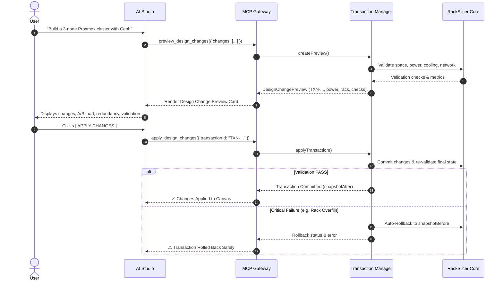

# RackSlicer – Secure MCP AI Control Plane Architecture & Threat Model

**Version:** 1.0.0  
**Classification:** Enterprise Infrastructure Security Specification  
**Authority:** RackSlicer Core Engine  

---

## 1. Executive Summary

RackSlicer is a professional datacenter infrastructure design platform for modeling floors, racks, compute, storage, power, cabling, cooling, and network topology. The **RackSlicer Secure MCP AI Control Plane** enables authorized AI models (Gemini, Claude, OpenAI, DeepSeek, Local LLMs) to manipulate and query datacenter infrastructure through natural language without granting the AI access to source code, databases, shell execution, or sensitive credentials.

The Model Context Protocol (MCP) acts as a **strictly typed, fail-closed, authenticated control-plane adapter** over RackSlicer Core APIs. RackSlicer Core remains the ultimate source of truth for validation rules, physics, and design state.

---

## 2. Core Security Boundary

```
                              INTERNET / AI PROVIDER
                                       |
                                       v
                     +-----------------------------------+
                     |       RackSlicer AI Studio        |
                     +-----------------------------------+
                                       |
                                       v
                     +===================================+
                     |         MCP GATEWAY               |
                     | --------------------------------- |
                     | 1. Prompt Injection Defenses      |
                     | 2. Prohibited Command Filter      |
                     | 3. Multi-Tenant Isolation         |
                     | 4. Role-Based Access (RBAC)       |
                     | 5. Schema Validation & Sanitizer  |
                     | 6. Sliding-Window Rate Limiter    |
                     | 7. Immutable Audit Trail          |
                     | 8. Zero-Leak Error Mapper         |
                     +===================================+
                                       |
                     Authenticated Domain Operations Only
                                       |
                                       v
                     +-----------------------------------+
                     |      RackSlicer Core APIs         |
                     +-----------------------------------+
                                       |
                                       v
                     +-----------------------------------+
                     |   StateManager & Domain Engine    |
                     |  (Capacity, Power, Heat, Routing) |
                     +-----------------------------------+
                                       |
                        +--------------+--------------+
                        |                             |
                        v                             v
               Canvas State (2D/3D)            Device Catalog
```

---

## 3. Strict Prohibitions (Zero Arbitrary Execution)

The MCP Gateway enforces a zero-trust policy. AI models **NEVER** receive or execute:
- Shell / terminal commands (`execute_command`, `run_shell`, `exec`, `spawn`)
- Code evaluation (`eval`, `execute_javascript`, `run_python`, `execute_code`)
- Arbitrary SQL (`execute_sql`, `DROP TABLE`, `TRUNCATE`)
- Direct filesystem access (`access_filesystem`, file reading/writing outside sanctioned resources)
- Container / orchestration commands (`run_docker`, `run_kubernetes_command`)
- Raw credentials, connection strings, API secrets, private keys, or system paths

Every AI capability is exposed exclusively as a strongly typed, allowlisted domain operation.

---

## 4. Two-Phase Transactional Mutation Model

AI models are prohibited from making uncontrolled sequences of direct mutations. All structural modifications follow a two-phase transactional workflow:



---

## 5. Role-Based Access Control (RBAC) Matrix

| Operation Category | Tools | Viewer | Designer | Architect | Admin |
| :--- | :--- | :---: | :---: | :---: | :---: |
| **Read Design** | `get_current_design`, `get_current_rack`, `get_current_topology`, `get_current_power`, `get_current_cooling`, `get_bom` | ✅ | ✅ | ✅ | ✅ |
| **Catalog** | `search_library`, `get_equipment` | ✅ | ✅ | ✅ | ✅ |
| **Validation** | `get_validation_status`, `validate_design`, `validate_redundancy`, `calculate_heat_load` | ✅ | ✅ | ✅ | ✅ |
| **Optimization** | `optimize_rack_space`, `optimize_power` | ❌ | ❌ | ✅ | ✅ |
| **Preview** | `preview_design_changes` | ❌ | ✅ | ✅ | ✅ |
| **Equipment Mutations** | `add_equipment`, `move_equipment`, `connect_ports`, `disconnect_ports` | ❌ | ✅ | ✅ | ✅ |
| **Rack & Destructive** | `create_rack`, `remove_equipment`, `configure_power`, `apply_design_changes` | ❌ | ❌ | ✅ | ✅ |
| **System Rollback** | `remove_rack`, `rollback_design_changes` | ❌ | ❌ | ❌ | ✅ |

---

## 6. Execution Modes

1. **Advisory Mode:**  
   AI generates plans, thermal recommendations, and previews, but **CANNOT** mutate the design canvas.
2. **Assisted Mode (Default):**  
   AI generates a structured `DesignChangePreview`. The user reviews the visual breakdown of equipment, power feeds, and validation badges, then explicitly clicks `[ APPLY CHANGES ]` or `[ MODIFY ]`.
3. **Controlled Autonomous Mode:**  
   AI can apply non-destructive changes directly within safety policy. Any operation requiring approval (destructive removal, exceeding capacity, or breaking redundancy) is automatically paused for human confirmation.

---

## 7. STRIDE Threat Model & Mitigations

| Threat (STRIDE) | Attack Vector | Control Plane Mitigation |
| :--- | :--- | :--- |
| **Spoofing** | Forged user identity or API keys | Enforced `McpRequestContext` with tenant validation on every tool call. |
| **Tampering** | Malicious JSON diff injecting unauthorized objects | Strict JSON Schema validation; invalid RU slots or ports rejected before execution. |
| **Repudiation** | Denying an unauthorized infrastructure wipe | Immutable audit logging with `requestId`, `userId`, `tenantId`, duration, and sanitized arguments. |
| **Information Disclosure** | Prompt injection extracting DB credentials or backend files | `McpSanitizer` regex checks; Zero-Leak error mapper scrubs paths, tokens, and stack traces. |
| **Denial of Service** | Flooding tool calls with thousands of compute nodes | Sliding-window rate limiter (120 req/min); RU capacity validation limits over-allocation. |
| **Elevation of Privilege** | Viewer attempting to delete racks | RBAC enforcement checks role hierarchy before tool dispatcher is reached. |

---

## 8. Natural Language Command Examples

Users can control the datacenter design with natural phrases:

- *"Create a 42U rack"*
- *"Add three Dell PowerEdge R770 servers"*
- *"Build me a 3-node Proxmox cluster with Ceph"*
- *"Connect the servers using redundant 25GbE networking"*
- *"Add A/B power"*
- *"Validate the entire design"*
- *"Show me what's missing"*
- *"Optimize the rack for power"*
- *"Apply the changes"*
- *"Rollback"*
